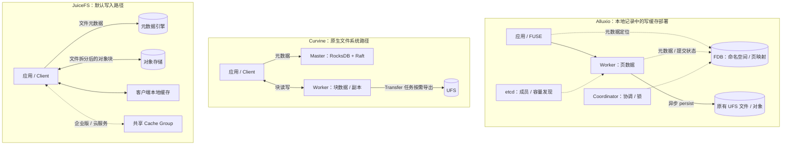

# Alluxio、Curvine 与 JuiceFS：架构、功能和性能对比

资料核对日期：2026-09-28。Curvine 代码基线：`f1fce2f454156127d2335fa11b7bf5c3665a62f5`（当前 `dev` 的起点）。

## 1. 选型结论与比较范围

**如果主要问题是加速现有 OSS/S3/HDFS 数据，优先比较 Alluxio 与 Curvine；如果主要问题是建设长期共享文件系统，JuiceFS 更直接契合。** 三者都有缓存能力，但数据归属、写入完成条件和部署方式不同。以下场景建议是基于后文证据的工程判断，不是同环境压测排名。

| 目标 | 优先评估 | 决定因素 |
| --- | --- | --- |
| 保留既有对象路径，加速训练读取、模型分发 | Alluxio Enterprise AI、Curvine | UFS 访问、命中率、跨节点吞吐、预热和失效策略。 |
| 用集群 NVMe 吸收 checkpoint 写入突发，再异步落 OSS | 已部署的 Alluxio write-cache | 已有部署依据；需验证写回积压、未持久化副本和故障恢复。Curvine 的 `write_cache` 开关不能直接替代该语义。 |
| 开源、可修改的分布式缓存与临时文件系统 | Curvine | Rust 客户端/服务端、块副本、原生文件系统模式；用业务负载验证可靠性和运维成本。 |
| 多机器共享工作目录、文件资产长期保存 | JuiceFS 社区版或企业版 | 对象存储承载数据、数据库承载命名空间；文件接口和元数据运维是核心。 |
| 以 JuiceFS 管理训练数据，并共享集群缓存 | JuiceFS 企业版/云服务 | 需把分布式缓存的版本能力与成本纳入比较，不能套用社区版配置。 |

本文严格区分以下对象：

- **Alluxio 部署实证**：用户提供的 [Alluxio Write-Cache 架构技能][local-alluxio]，记录 `AI-3.9-16.0.2` 部署与 2026-09 的测试。本次只阅读记录，没有重新连接集群验证。
- **Alluxio 公开能力**：Enterprise AI 文档中的 DORA 读缓存、FDB 写缓存，以及必要的开源版接口差异。公开文档不等于当前部署镜像已开启全部能力。
- **Curvine**：以本仓库源码为准，公开文档用于补充背景和性能资料。
- **JuiceFS**：社区版作为基本文件系统对照；企业版/云服务的专有元数据和分布式缓存单独说明。公开文档为核对日快照，未锁定单一发布版本。

证据分为“本地部署记录”“源码可见行为”“官方公开描述/测试”和“本文推断”。本文未执行三者的部署或性能测试。

## 2. 核心架构：数据与元数据分别归谁管理

| 维度 | Alluxio（重点为现有写缓存） | Curvine（当前源码） | JuiceFS |
| --- | --- | --- | --- |
| 系统定位 | 外部存储前的统一访问与缓存层；写回模式会持有尚未进入 UFS 的新数据 | 分布式缓存文件系统，兼有 UFS 缓存模式和 Curvine 管理的文件系统模式 | 由元数据引擎与对象存储共同构成的共享文件系统 |
| 元数据主链路 | 现有写缓存使用 FDB 保存命名空间及页位置；coordinator 承担协调/锁等职责 | Master 管理 inode、目录、块位置；RocksDB 存储，Raft 复制日志与恢复 | 社区版使用 Redis、TiKV、SQL 等元数据引擎；企业版采用专有元数据服务 |
| 文件数据布局 | 部署记录为 page 存储、按文件粘性选 Worker | 文件拆成 block；Master 返回位置，客户端直接访问 Worker | 文件映射成 chunk/slice/block，数据块写入对象存储 |
| 读缓存共享 | Worker 提供集群共享缓存 | Worker 提供集群共享缓存 | 社区版主要为客户端缓存；企业版/云服务提供 cache group |
| 持久化责任 | 写回完成前依赖 Worker 数据和 FDB 元数据；完成后可用 UFS 数据 | `cache_mode` 以 UFS 为主；原生文件/`fs_mode` 依赖 Curvine 元数据与块数据，导出另行处理 | 通常以元数据引擎与对象存储为持久化基础；开启客户端 writeback 后增加本地暂存风险窗口 |
| 扩展方式 | 读缓存与写缓存的元数据路径不同；写缓存还要考虑 FDB 事务负载 | 增加 Worker 扩数据面；Master 高可用副本不等同于元数据自动分片 | 数据量主要扩展对象存储；元数据吞吐取决于引擎，企业缓存可独立扩展 |

来源：[Alluxio 本地记录][local-alluxio]、[Alluxio AI 架构][a-arch]、[Curvine 基本架构][c-arch]、[JuiceFS 架构][j-arch]、[JuiceFS 版本差异][j-editions]。Curvine 各路径的源码证据见第 8 节。



这是职责示意图，不表示每次 `read` 都需要一次元数据 RPC。图中的 Curvine 原生路径也不代表 `cache_mode` 的 UFS 写入路径。

### Alluxio 的独特设计与版本边界

现有部署记录显示：FDB 保存“文件 → 页 → Worker”的持久映射，etcd 主要参与 Worker 成员/容量发现，页数据落在 Worker 本地盘；`PINNED_CAPACITY_BASED` 按容量选择文件所属 Worker。这种布局使单个文件的写入与 persist 集中在所属 Worker，多文件可以分散。由此推断，增加 Worker 主要扩展多文件聚合能力，不能直接认为单文件带宽会线性提升。[本地部署记录][local-alluxio]

公开的 AI 读缓存架构则通过一致性哈希把请求路由到 Worker，coordinator 不处于读 I/O 关键路径；当前文档描述的是页缓存。**不能将传统开源 Master 架构、AI 读缓存架构和 FDB 写缓存架构混成一套。** 读缓存的“可回源”也不适用于尚未 persist 的最新写入。[Alluxio AI 架构][a-arch]

本地技能中的“无副本概念”应理解为该部署观察，而不是产品能力结论：公开 S3 写缓存文档已提供 `writeReplicas > 1`，同时仍标注该特性自 AI-3.8 起为实验性。它有 API/版本边界，不能据此断言当前 FUSE 集群已经具备或启用了同步多副本。[Alluxio S3 写缓存][a-write]

### Curvine 的独特设计与当前实现

Curvine 将命名空间与块位置集中在 Master，文件内容由 Worker 服务，客户端可选择本地短路或远程读写。块写入器对已分配的位置并发写入、flush 和 complete；另有后台补副本管理。因此应分别检查前台分配的副本数、提交结果和后台修复状态，不能只看配置中的目标副本数。[块写入器][c-block]、[副本管理][c-replication]

它的特点是把文件系统和缓存策略放在同一套可修改的 Rust 代码中：统一文件系统负责 UFS 路由，Transfer 负责加载/导出，底层存储通过 adapter 扩展。`curvine-mds` 虽已有内存/FDB 的 KV 后端和服务生命周期，但当前 `start()` 未建立完整文件元数据 RPC 服务；它还不是现有 Master 的分布式替代品。[统一文件系统][c-unified]、[Transfer][c-transfer]、[MDS][c-mds]

### JuiceFS 的独特设计与迁移含义

JuiceFS 的 chunk 用于定位，slice 描述写入片段，再拆成对象块存储；chunk 最大 64 MiB，block 默认最大 4 MiB。文件覆盖写会形成新的数据片段，需要通过元数据映射和压缩合并控制碎片。对象存储内通常不是“一个原始文件对应一个同名对象”，因此接入既有 OSS 数据不能直接等同于 Alluxio/Curvine 的 UFS 挂载。[JuiceFS 架构][j-arch]

企业版 cache group 以一致性哈希定位共享数据块，缓存节点可与计算混部或独立部署；缓存失效后回源对象存储。独立缓存集群是企业版/云服务能力。对选型的含义是：JuiceFS 可以同时承担文件系统和训练缓存，但社区版与企业版的成本及拓扑不能混算。[分布式缓存][j-distributed]、[CSI 缓存版本范围][j-csi]

## 3. 写缓存语义：相同名称，不同完成条件

以下“完成”指对应路径的 flush/complete/close 等提交阶段，**不把一次普通 `write()` 返回视为最终持久化**。底层介质的掉电保证还取决于实际存储、同步实现与故障域。

| 模式 | 前台路径与完成条件 | 最新数据的风险窗口 |
| --- | --- | --- |
| Alluxio `WRITE_BACK` | 先进入 Worker 缓存，后台 persist 到 UFS | 尚未 persist 的数据依赖有效 Worker 副本 |
| Alluxio `WRITE_THROUGH` | 公开 S3 文档要求缓存与 UFS 两侧完成 | 写延迟仍受 UFS 影响 |
| Alluxio `TRANSIENT` | 只保留缓存数据 | 不会自动获得 UFS 持久化保障 |
| Curvine `cache_mode` | 写入 UFS；可选 `write_cache` 镜像 | 持久化结果以 UFS 写入路径为基础 |
| Curvine `cache_mode + write_cache` | 先调用 UFS writer，再向异步镜像队列发送数据；complete 先完成 UFS | 镜像失败可放弃缓存，不等于 UFS 写失败；UFS 故障不能靠该开关变成纯缓存提交 |
| Curvine 原生文件 / `fs_mode` | 写 Curvine 块，提交 Master 元数据 | 数据安全取决于实际块副本和存储；不能默认认为已经自动写回 UFS |
| JuiceFS 默认模式 | 数据上传对象存储后提交文件写入元数据 | 对象存储和元数据引擎共同承担持久化责任 |
| JuiceFS `--writeback` | 先本地 staging 与元数据提交，后台上传 | 上传前依赖写入客户端暂存盘；跨客户端读取可能等待上传 |

来源：[Alluxio S3 写策略][a-write]、[Curvine 挂载模式][c-mount]、[Curvine 镜像写入器][c-writecache]、[JuiceFS 社区版写缓存][j-cache]。

**对当前 Alluxio 写缓存替换最关键的结论：Curvine `write_cache` 更接近“写 UFS 的同时填充读缓存”，不能仅凭名称当成“NVMe 接收成功后异步持久化”。** 源码在镜像失败、非顺序 seek、resize 等情况下会放弃镜像；缓存有效性在 UFS 完成后结合其 mtime 发布。要用 Curvine 达到相同业务目标，需要组合 `fs_mode`、数据导出、积压管理、重试和恢复验证，不能把组件存在等同于整套写回契约已成立。[镜像写入器][c-writecache]、[路径选择][c-unified]

JuiceFS 企业版的 `--fill-group-cache` 可把 staging 数据异步发送到共享缓存，但异步发送不等于在返回前等待多个副本确认。也不要把 FUSE 的 `-o writeback_cache` 与 JuiceFS 的 `--writeback` 混为一谈：前者是内核写合并，后者改变对象存储上传时序。[JuiceFS 企业版缓存][j-cloud-cache]

## 4. 功能、兼容性与运维对比

| 维度 | Alluxio | Curvine | JuiceFS |
| --- | --- | --- | --- |
| 既有数据湖访问 | UFS 统一命名空间是核心能力 | 挂载 UFS，可按缓存/文件系统模式使用 | 基础文件系统采用自有对象块布局，需规划导入、同步或其他特定接入能力 |
| 应用接入 | AI 文档重点为 FUSE、S3、Python FSSpec；开源版另有自身接口矩阵 | Rust、FUSE、CLI、Java/Python SDK，仓库含 CSI | FUSE/POSIX、HDFS SDK、S3 网关、CSI |
| 文件修改能力 | AI FUSE 有可选随机写/追加，但文档明确不完全 POSIX；开源版限制不同 | 源码含随机写、truncate、link、锁、属性相关实现；UFS 模式仍受后端能力约束 | POSIX 语义是核心设计目标，有原子元数据操作、锁、mmap 等兼容说明 |
| 读缓存与一致性 | 需按 AI/开源版本和 UFS 变更同步策略确认 | `read_verify_ufs` 可核对 mtime/长度；验证失败或未命中可回源并触发加载 | 默认 close-to-open；增大元数据缓存可能改变跨客户端可见性 |
| 元数据扩展 | AI 读路径去中心化；当前写缓存引入独立 FDB 依赖 | 当前 Master + Raft，不能因增加 Master 副本就承诺元数据线性扩展 | 社区版取决于数据库引擎；企业版专有服务应独立评估 |
| 运维重点 | 当前写缓存需协调 FUSE、Worker、coordinator、etcd、FDB、Operator/CSI | Master 日志/快照与 RocksDB、Worker 磁盘/副本、FUSE、可选 Transfer 状态库 | 元数据高可用/备份、对象存储、客户端缓存；企业版另加共享缓存集群 |

接口依据：[Alluxio AI FUSE][a-fuse]、[Alluxio 开源 FUSE][a-os-fuse]、[JuiceFS 接入能力][j-intro]。缓存一致性依据：[Curvine 缓存策略][c-cache-doc]、[JuiceFS 缓存][j-cache]。Curvine 源码入口见第 8 节。

兼容性已有公开测试证据，但不能按通过数量直接排名：Curvine 2026-08 的 LTP 报告为 1,129 通过、141 跳过；JuiceFS 文档列出 pjdfstest 与 LTP 结果，两者的 LTP 版本、系统和筛选集不同。实际替换还应测试多客户端并发写、rename、锁、fsync、进程退出及挂载恢复等业务依赖。[Curvine LTP 报告][c-ltp]、[JuiceFS POSIX 兼容说明][j-posix]

**工程判断：** 同样一份训练数据，读缓存丢失通常可以通过回源恢复性能；未持久化写缓存丢失则可能丢最新数据。元数据有 FDB/Raft 副本不能代替文件内容副本。JuiceFS 的对象块仍在也不意味着命名空间能自动重建，元数据备份与恢复必须成为文件系统运行方案的一部分。

## 5. 性能：现有证据与可比较范围

### 5.1 可引用的测量结果

| 来源与性质 | 环境/口径 | 结果摘录 | 能支持的结论与限制 |
| --- | --- | --- | --- |
| Alluxio 本地技能记录，2026-09-21；本次未复测 | 单 FUSE、单 Worker、4 NVMe；fio 256 KB、多 job；8 文件约 859 GB | 记录持续约 9–10.5 GB/s，峰值 12.36 GB/s；write 平均延迟约 0.13 ms | 说明该部署有高前台缓存接收带宽；缺完整 fio 参数、原始时序和同步时延，不能解释为同等 UFS 持久化吞吐 |
| Curvine README 自报数据 | 256K、32 线程；对照标为开源 Alluxio | 顺序读 9.5 vs 8.8 GiB/s；随机读 7.8 vs 0.3 GiB/s | 没有完整绑定版本、挂载和缓存状态，不代表当前 Enterprise AI；随机读不是随机写 |
| Alluxio 官方 MLPerf v2.0 文档 | AWS 同 AZ，8 FUSE + 8 Worker，数据已预热；ResNet-50、128 模拟加速器 | 24.1364 GiB/s | 有明确节点规格与负载；这是缓存命中训练读，不是 checkpoint 写回 |
| Curvine 2026-09-07 内部 MLPerf 方法对比 | 声称使用同类 AWS 规格；ResNet-50 同为 8 FUSE + 8 Worker | 23.83 GiB/s，对照 Alluxio 约 24.14 GiB/s | 接近公开基线，但 Curvine 不是正式 MLCommons 提交；文章部分原始单位存在 GB/s、GiB/s 标注解释，需原始日志复核 |
| JuiceFS 企业版/云服务文档中的 MLPerf v2.0 结果 | GCP，10 客户端 + 10 缓存节点，GCS 数据提前预热 | U-Net3D：108 GiB/s、40 模拟 H100、AU 92.7%；ResNet-50：90 GiB/s、500 模拟 H100、AU 95% | 拓扑规模、硬件和负载规模不同，不能用 108 或 90 除以 Alluxio/Curvine 带宽得出产品倍数 |

表格来源依次为：[本地实测记录][local-alluxio]、[当前仓库 README](../README.md)、[Alluxio MLPerf 文档][a-mlperf]、[Curvine 内部对比][c-mlperf]、[JuiceFS MLPerf 文档][j-mlperf]。官方结果与提交材料可进一步从 [MLCommons 结果仓库][ml-results]复核；本文没有逐一重放原始运行。MLPerf Storage 的模拟加速器/AU 不应表述成真实 GPU 完整训练的实测结果。

Curvine README 的元数据对照还引用了其他产品文章的数据。即使并发数相同，也缺少同机、同版本、同持久化配置的完整证据；因此这里不据此排出三者的元数据 QPS 名次。Rust、JVM 或 Go 的语言选择本身，也不能证明某产品必然更省 CPU 或内存。

### 5.2 从架构推断性能边界

以下是分析模型，不是测试结果。

| 负载 | 主要瓶颈 | 比较时真正要看什么 |
| --- | --- | --- |
| 顺序读大文件 | 缓存盘、客户端 CPU、网卡与并发度 | 本地/远程命中是否分开；单文件与多文件是否分开 |
| 大量小文件训练 | open/stat/lookup、元数据缓存、FUSE 开销与尾延迟 | 样本供给速度、P99、AU；只看 GB/s 会漏掉等待 |
| 稀疏随机读 | 预读、页/块粒度、实际回源字节数 | 读放大与缓存污染，不能仅看请求大小 |
| 高频随机覆盖写 | 提交频率、锁、块/片段更新方式、UFS 能力 | Curvine 原生路径与 UFS 路径分别测；JuiceFS 关注碎片合并；Alluxio 检查版本开关 |
| 突发 checkpoint | 前台接收速度、剩余脏数据空间、后台上传速度 | 训练暂停多久、多久能在干净客户端/灾后恢复，而非仅 `write()` 耗时 |
| 持续写入 | 后端长期持久化速率 | 缓存只能暂时吸收差额，不能无限掩盖 UFS 带宽不足 |

对异步写回，可用以下简化模型规划容量：

```text
Rin  = 前台接受的逻辑数据速率
Rout = 后台完成持久化的逻辑数据速率
C    = 扣除副本与预留后，可用于新增脏数据的逻辑容量

若 Rin > Rout：预计填满时间 ≈ C / (Rin - Rout)
停止写入后的排空时间 ≈ 剩余脏数据量 / Rout
```

例如假设可用脏数据空间为 10 TB、前台 10 GB/s、后台 2 GB/s，持续写入约 1,250 秒（20.8 分钟）就会消耗完这部分空间。这是十进制单位下的假设计算，不是现有 Alluxio 集群的容量测量；副本、读缓存占用和回收延迟都会改变结果。

本地技能中的 Prometheus `rate` 思路应保留，但集群吞吐要对**去重后的目标实例速率求和**，区分读写、成功与失败及统计层级；对实例做 `max` 只能得到最大单实例值。带宽可用同一测量窗口的成功字节增量/时间或 fio 汇总交叉核对，不能除以 Pod 存活时间。前台 FUSE、Worker 网络、物理盘写入和 UFS 上传是四种口径。

## 6. 哪些场景适合谁

### 6.1 现有 OSS/HDFS 数据湖与模型分发

**优先比较 Alluxio 与 Curvine。** 两者的 UFS 接入能保留现有数据来源，适合重复读、训练预热和模型权重分发。Alluxio 的 AI 架构和商业集成值得作为基线；Curvine 适合希望自行控制源码、部署与优化路线的团队。评估重点是多消费者同时冷启动、跨节点缓存命中、源文件更新后的可见性及回源风暴。

JuiceFS 更适合愿意由其管理文件生命周期的数据平台；若数据必须继续被外部系统以原始对象键直接消费，先核对导入/同步与数据格式要求。[Alluxio 定位][a-intro]、[Curvine 缓存策略][c-cache-doc]、[JuiceFS 架构][j-arch]

### 6.2 自动标注、中间结果与 checkpoint 突发写入

对已有的 Alluxio write-cache，先保留为基线，测“写后立即跨节点读取”和“Worker 丢失后恢复”的完整流程。粘性文件布局下，应把单个超大文件与多文件并行分开测试。

Curvine 原生文件系统值得评估为中间数据存储，但替换方案要明确何时导出、谁负责重试、删除前是否已持久化，以及剩余副本不足时如何处理。JuiceFS 默认上传后提交更适合需要后续任务稳定共享的数据；其客户端 writeback 可加速局部突发，却不宜未经验证就作为多节点立即消费的等价方案。上述判断分别基于[当前部署记录][local-alluxio]、[Curvine 写路径][c-unified]和[JuiceFS 写缓存限制][j-cache]。

### 6.3 长期共享目录、文件资产和 Kubernetes 持久卷

**优先评估 JuiceFS。** 文件系统语义和对象存储持久化是其基础设计，可从社区版起步，并按元数据容量与缓存共享需求评估企业版。代价是必须维护元数据可靠性，以及接受对象块布局。[JuiceFS 产品能力][j-intro]、[POSIX 说明][j-posix]

Curvine 可以作为候选，但应把持久化、快照/备份、容量耗尽和故障恢复放在纯吞吐之前验收。Alluxio 的 FUSE 接口存在版本相关限制，不能仅因能挂载 PVC 就认为适用于所有通用文件工作负载。[Alluxio FUSE 限制][a-fuse]

### 6.4 大规模训练与高复用热数据

三者均值得评估，但应比较匹配的版本：Alluxio Enterprise AI、Curvine、JuiceFS 企业版/云服务的共享缓存部署。JuiceFS 社区版的客户端本地缓存也是一种选项，但重复下载与缓存副本分布不同，不能当作同一拓扑。[JuiceFS 缓存版本范围][j-csi]

对于只读一次、不能复用缓存的 ETL，额外缓存服务未必带来收益。对于强依赖低延迟同步随机写和精确锁语义的数据库目录，应按应用的 fsync、并发修改和崩溃恢复要求单独验收，不能从训练读带宽推导适用性。

## 7. 建议的同条件验证方案

这是后续测试设计，尚未执行。先固定物理节点、NVMe/网卡、CPU/内存限额、操作系统、FUSE/SDK、数据量、软件版本、元数据高可用和副本策略，再比较以下两类契约：

- **缓存接收契约**：返回时数据已到哪里、有几个实际副本、客户端退出后能否读取。所有系统采用等价保障后比较前台延迟。
- **最终持久化契约**：返回或观察完成时，对象存储已经具备可恢复数据与必要元数据。比较全流程完成时间、而不是把异步接收与同步持久化直接对照。

| 测试组 | 操作与控制变量 | 必须报告 |
| --- | --- | --- |
| 读吞吐 | 冷读、Worker/cache-group 热缓存、客户端 page cache 命中分开；本地与跨节点分开 | GB/s 或 GiB/s、UFS 流量、命中率、CPU、P95/P99 |
| 元数据 | create/stat/open/list/rename/unlink；分散目录和热点目录 | 各操作 QPS、尾延迟、元数据 CPU/磁盘、错误率 |
| checkpoint | 单大文件、多文件、多客户端；周期性突发与持续写 | write/close/fsync 分项时延、后台积压、最终持久化时间 |
| 多客户端语义 | 写后另一节点读取、并发覆盖、追加、rename、锁 | 可见性延迟、校验和、错误语义 |
| 故障恢复 | 隔离测试环境中停止 FUSE/Worker、模拟本地盘丢失、元数据切主及 UFS 中断 | 已确认数据是否丢失、可恢复时间、失败请求数、积压恢复速度 |
| 应用收益 | DLIO/MLPerf Storage 或真实训练/标注流程 | AU、样本/s、训练/任务暂停时间、资源成本 |

每组至少重复 3 次，保留原始 fio/DLIO 配置、日志和时序。不要假设 `direct=1` 能消除所有 FUSE/服务端缓存；通过缓存状态与回源字节验证。成本按客户端/FUSE、缓存节点、元数据节点、FDB/etcd、对象请求与网络等全量核算，避免只比较 Worker RSS。

对当前场景，优先级最高的验证是：**Alluxio 的实际未持久化副本策略；Curvine 原生写入到 UFS 导出的完整闭环；JuiceFS 默认写入和 writeback 下的跨节点可读时间。** 这三项决定方案是否满足业务，再比较吞吐与成本。

## 8. 源码与资料索引

### Curvine 源码核对点

| 文件/符号 | 支持的判断 |
| --- | --- |
| [Master 初始化][c-master]、[JournalSystem][c-journal] | Master 组织文件系统、Raft 日志、挂载和任务管理 |
| [MountInfo / WriteType][c-mount] | `cache_mode`、`fs_mode` 与 `write_cache` 条件 |
| [UnifiedFileSystem::open_with_opts][c-unified] | 原生、FsMode 与 UFS writer 的路由 |
| [WriteCacheWriter][c-writecache] | UFS 主写、异步镜像、镜像放弃及完成顺序 |
| [BlockWriter][c-block]、[MasterReplicationManager][c-replication] | 前台多位置写入与后台副本修复 |
| [FUSE 文件系统][c-fuse]、[CSI](../curvine-csi/) | 文件系统操作和 Kubernetes 接入 |
| [TransferServer][c-transfer]、[LoadTaskRunner][c-transfer-task] | 任务服务及 Worker 搬运执行 |
| [Mds][c-mds] | 当前独立 MDS 的实际实现范围 |

### 公开资料

- Alluxio：[AI 架构][a-arch]、[S3 写缓存与多副本][a-write]、[AI FUSE][a-fuse]、[开源 FUSE][a-os-fuse]、[MLPerf 数据][a-mlperf]。
- Curvine：[基本架构][c-arch]、[缓存策略][c-cache-doc]、[LTP 报告][c-ltp]、[MLPerf 方法内部对比][c-mlperf]。
- JuiceFS：[架构][j-arch]、[社区版缓存][j-cache]、[企业版缓存][j-cloud-cache]、[分布式缓存][j-distributed]、[版本差异][j-editions]、[POSIX 说明][j-posix]、[MLPerf 数据][j-mlperf]。
- 本地依据：[Alluxio Write-Cache 架构技能][local-alluxio]。其中历史拓扑、容量、清理时序及延迟仅属于记录中的环境；未经本次复核的“秒级恢复”等描述不作为通用性能承诺。

[local-alluxio]: /Users/shunqiwang/workspace/alluxio-deploy/.opencode/skills/alluxio-write-cache-architecture/SKILL.md
[a-intro]: https://documentation.alluxio.io/ee-ai-en
[a-arch]: https://documentation.alluxio.io/ee-ai-en/how-alluxio-works
[a-write]: https://documentation.alluxio.io/ee-ai-en/performance/s3-write-cache
[a-fuse]: https://documentation.alluxio.io/ee-ai-en/data-access/fuse-based-posix-api
[a-os-fuse]: https://documentation.alluxio.io/os-en/api/posix-api
[a-mlperf]: https://documentation.alluxio.io/ee-ai-en/benchmark/benchmarking-ml-training-performance-with-mlperf
[c-arch]: https://curvineio.github.io/docs/Architecture/introduction/
[c-cache-doc]: https://curvineio.github.io/docs/User-Manuals/Key-Features/cache/
[c-ltp]: https://curvineio.github.io/blog/2026/08/11/curvine-ltp-compatibility/
[c-mlperf]: https://curvineio.github.io/blog/2026/09/07/mlperf-storage-curvine-vs-alluxio/
[j-intro]: https://juicefs.com/docs/community/introduction/
[j-arch]: https://juicefs.com/docs/community/architecture/
[j-cache]: https://juicefs.com/docs/community/guide/cache/
[j-cloud-cache]: https://juicefs.com/docs/cloud/guide/cache/
[j-distributed]: https://juicefs.com/docs/cloud/guide/distributed-cache/
[j-csi]: https://juicefs.com/docs/csi/guide/cache/
[j-editions]: https://juicefs.com/en/blog/solutions/juicefs-enterprise-edition-features-vs-community-edition
[j-posix]: https://juicefs.com/docs/community/posix_compatibility/
[j-mlperf]: https://juicefs.com/docs/cloud/benchmark/mlperf_storage/
[ml-results]: https://github.com/mlcommons/storage_results_v2.0
[c-master]: ../curvine-master/src/master/master_server.rs
[c-journal]: ../curvine-master/src/master/journal/journal_system.rs
[c-mount]: ../crates/common/curvine-model/src/mount.rs
[c-unified]: ../crates/client/curvine-unified-fs/src/unified/unified_filesystem.rs
[c-writecache]: ../crates/client/curvine-unified-fs/src/unified/write_cache_writer.rs
[c-block]: ../crates/client/curvine-client-core/src/block/block_writer.rs
[c-replication]: ../curvine-master/src/master/replication/master_replication_manager.rs
[c-fuse]: ../curvine-fuse/src/fs/curvine_file_system.rs
[c-transfer]: ../crates/server/curvine-data-transfer/src/transfer/transfer_server.rs
[c-transfer-task]: ../crates/server/curvine-data-transfer/src/worker/task/load_task_runner.rs
[c-mds]: ../curvine-mds/src/server.rs
