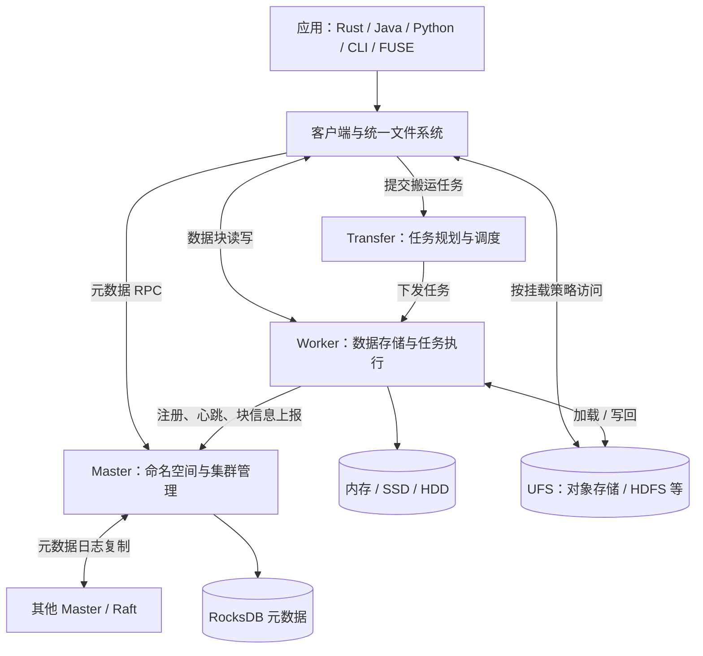

# Curvine 架构简述

本文基于提交 `f1fce2f4` 的代码结构，概述当前主要组件和访问链路。

选型与写缓存语义的进一步比较，见 [Alluxio、Curvine 与 JuiceFS 对比](alluxio-curvine-juicefs-comparison.md)。

Curvine 是使用 Rust 实现的分布式缓存文件系统。它通过统一文件系统接口访问集群内的数据，并可挂载对象存储、HDFS 等底层存储（UFS），将热点数据缓存在 Worker 上，为训练、模型分发及大数据计算等场景加速。

## 整体结构

核心设计是分离元数据管理与数据传输：客户端向 Master 查询或修改文件元数据，文件内容主要在客户端与 Worker 之间传输。

## 主要组件

| 组件 | 代码位置 | 职责 |
| --- | --- | --- |
| 服务启动入口 | `curvine-server` | 统一二进制，通过 `--service master/worker/transfer/mds` 启动不同角色。 |
| Master | `curvine-master` | 管理目录、文件、块位置、Worker 状态、UFS 挂载、配额和副本调度；使用 RocksDB 存储元数据，通过 Raft 日志与快照实现复制和恢复。 |
| Worker | `curvine-worker` | 管理本地数据块，响应读写请求，执行副本复制和数据搬运任务，并向 Master 上报状态。存储实现位于 `crates/adapters/curvine-storage-*`，SPDK 为可选能力。 |
| 客户端 | `crates/client` | `curvine-client-core` 处理元数据 RPC 和块读写；`curvine-unified-fs` 组合 Curvine 与 UFS 访问；`curvine-job-client` 对接任务服务。 |
| 数据传输服务 | `crates/server/curvine-data-transfer` | 提供独立 Transfer 服务，负责搬运任务的规划、调度和状态管理，同时包含 Worker 侧任务执行逻辑；任务状态支持内存、SQLite、MySQL、PostgreSQL 后端。 |
| UFS 适配 | `crates/common/curvine-ufs-api`、`crates/adapters/curvine-ufs-*` | 定义底层存储接口，并通过 OpenDAL 等适配对象存储、HDFS、本地文件系统；具体后端取决于编译特性与配置。 |
| 接入与运维 | `curvine-fuse`、`curvine-cli`、`curvine-libsdk`、`curvine-web` | 提供文件系统挂载、命令行、多语言 SDK、Web 管理和监控接口。 |

`curvine-mds` 已包含独立服务生命周期与事务 KV 抽象，支持内存后端和可选 FoundationDB 后端。但当前 `Mds::start()` 仅记录启动日志，尚未提供完整的文件元数据 RPC 服务；上图中的元数据主链路仍由 Master 承担。

## 典型访问流程

1. **读取 Curvine 文件**：客户端向 Master 获取文件及块位置信息，再从对应 Worker 读取数据块；本地访问路径具备短路读取实现。
2. **写入 Curvine 文件**：客户端向 Master 创建文件并申请块，向选定的 Worker 写入数据，再完成块和文件的元数据提交；副本由相关复制组件管理。
3. **访问 UFS 挂载路径**：统一文件系统根据挂载信息和缓存策略选择 Curvine 或 UFS。缓存未命中时可回源读取，并按策略触发加载任务；写入行为由挂载模式决定。
4. **批量加载或写回**：启用独立 Transfer 服务时，客户端提交任务，Transfer 规划并调度到 Worker，Worker 在 UFS 与 Curvine 之间搬运数据并汇报进度。Master 中也保留任务管理逻辑。

## 代码分层与扩展

- `crates/core`：异步运行时、网络、RPC、I/O、内存分配、指标等底层能力。
- `crates/common`：配置、协议、数据模型以及文件系统、存储、UFS 接口。
- `crates/adapters`、`crates/metadata`：存储和外部系统适配，以及 Raft 实现。
- `crates/client`、`crates/sdk`、`crates/server`：客户端、语言绑定公共能力和服务端数据传输逻辑。
- 顶层 `curvine-*`：服务角色与接入入口；部分模块（如 `curvine-client`、`curvine-ufs`）保留拆分后的兼容导出。

Worker 可通过增加节点扩展数据容量和吞吐；Master 的 Raft 复制负责元数据一致性，Worker 的数据副本负责块数据冗余，两者是不同机制。实际缓存介质、UFS 后端和可选服务以集群配置及构建特性为准。

## 源码入口

- [服务角色选择](../curvine-server/src/bin/curvine-server.rs)
- [Master 初始化](../curvine-master/src/master/master_server.rs)与[元数据日志系统](../curvine-master/src/master/journal/journal_system.rs)
- [Worker 初始化](../curvine-worker/src/worker/worker_server.rs)
- [统一文件系统](../crates/client/curvine-unified-fs/src/unified/unified_filesystem.rs)
- [Transfer 服务](../crates/server/curvine-data-transfer/src/transfer/transfer_server.rs)
- [MDS 当前实现](../curvine-mds/src/server.rs)
